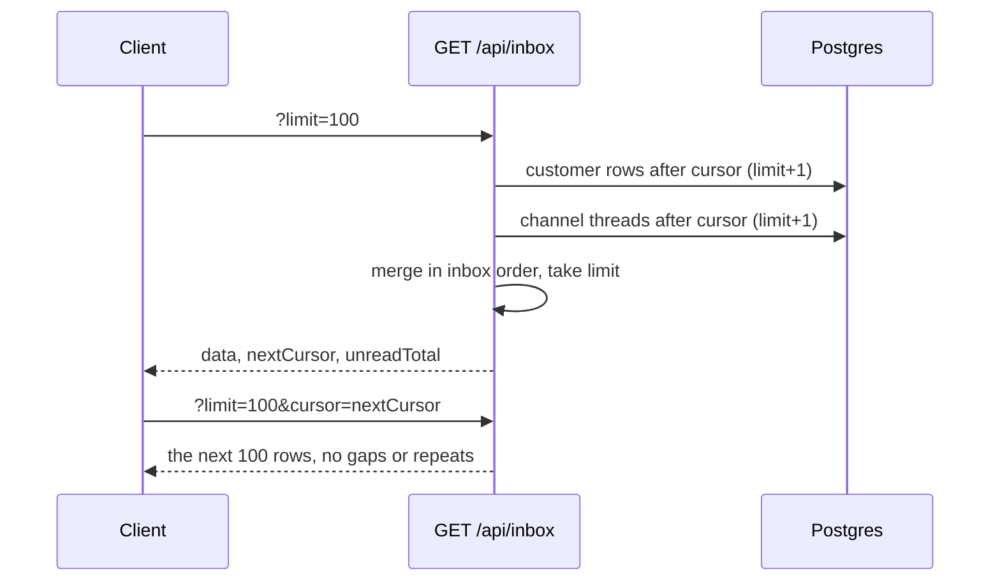

# Inbox API

> Base path: `/api/inbox` · 1 endpoint

The unified inbox: every conversation the reader can see, across every
channel, in one server-side order with cursor paging. It is what the web chat
list and the MCP `list_conversations` tool read.

| Method | Path | Access | Description |
|--------|------|--------|-------------|
| GET | `/inbox` | Authenticated · Tenant context | List the inbox, newest activity first. |

## Rows

The inbox has two row kinds, ordered together:

- **Customer rows** (`type: "contact"`) – WhatsApp linked-device contacts and
  merged customers, in the same shape as `GET /api/contacts` rows. A merged
  customer is one row, with its threads' unread, activity and accounts rolled up.
- **Channel threads** (`type: "conversation"`) – conversations with no
  customer row (for example Telegram), in the same shape as
  `GET /api/conversations` rows plus `assignedTo`. Listed only where the
  workspace's channel-spine neutral reads are enabled.

Order: last activity descending (rows with no activity last), customer rows
before threads on an exact tie, then id descending.

## Query

| Param | Default | Notes |
|-------|---------|-------|
| `limit` | 100 | 1–100 |
| `cursor` | – | Continue down from a page's `nextCursor`. |
| `before` | – | Page back up from a page's `prevCursor`. Not with `cursor`. |
| `search` | – | Name, username, phone (digits match formatted input); thread subject and counterpart name/handle. |
| `accountId` | – | A WhatsApp connection or a channel account. |
| `tagIds` | – | Comma-separated tag UUIDs (any). |
| `includeGroups` | `true` | `false` lists direct conversations only. |
| `filter` | `all` | `assignedToMe`, `unassigned` or `unread`. |
| `conversationStatus` | `all` | `open`, `pending`, `resolved` or `all`. |

Every filter is applied in SQL to both row kinds before paging, so a page is
never short because rows were dropped afterwards. Members without the
`can_view_all_chats` permission see only conversations assigned to them.

## Response

```json
{
  "data": [
    { "type": "contact", "contact": { "id": "…", "displayName": "…" } },
    { "type": "conversation", "conversation": { "id": "…", "channel": "telegram" } }
  ],
  "nextCursor": "WyIxNzkz…",
  "prevCursor": null,
  "unreadTotal": 12
}
```

- `nextCursor` / `prevCursor` are opaque; `null` at the end / top.
- `unreadTotal` (first page only, `null` on later pages) is the open-inbox
  unread total across every channel, with the same visibility. It drives the
  navigation badge.

## Cursor paging



Cursors are keyset positions (activity in microseconds, row kind, id), not
offsets: new activity that moves a row to the top while someone scrolls never
duplicates or skips the rows behind the cursor.
