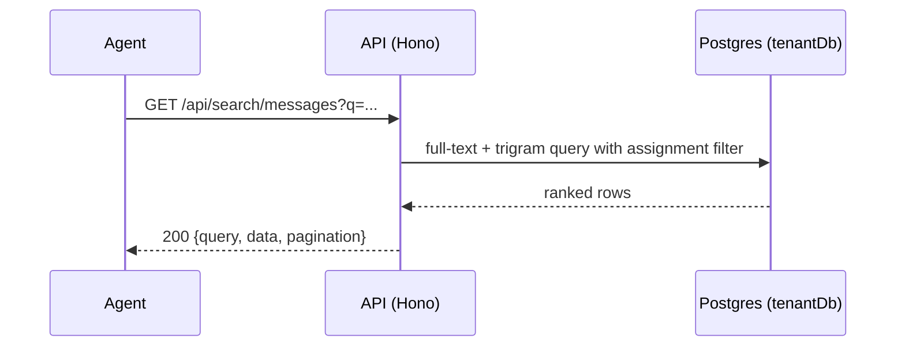

# Search API

> Base path: `/api/search` · 3 endpoints

Full-text search across messages and contacts, served by PostgreSQL full-text and trigram indexes in the tenant schema. Results are returned directly by the search service (not hydrated afterward).

## Endpoints

**Methods:** GET 3 · POST 0 · DELETE 0 · PATCH 0 · PUT 0

| Method | Path | Access | Description |
|--------|------|--------|-------------|
| GET | `/search` | Authenticated · Tenant context · Rate limited · Contact visibility (result-filtered) | Global search across messages and contacts |
| GET | `/search/contacts` | Authenticated · Tenant context · Rate limited · Contact visibility (result-filtered) | Search contacts only |
| GET | `/search/messages` | Authenticated · Tenant context · Rate limited · Contact visibility (result-filtered) | Search messages only |

## Flows

### Search

